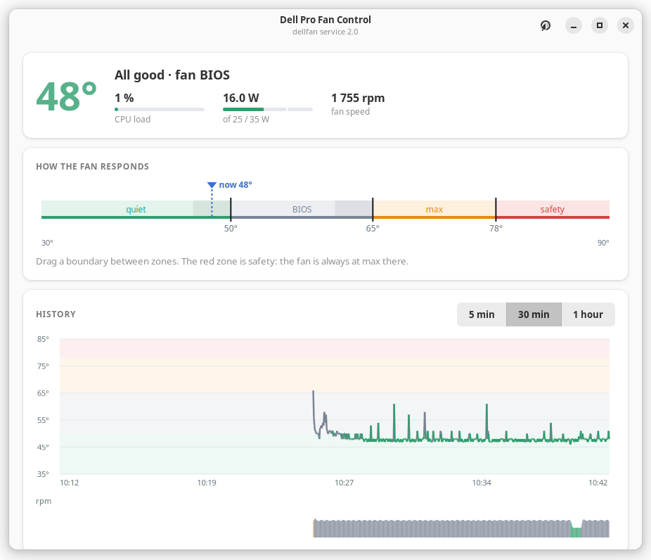

# Dell Pro Fan Control — fan curve and CPU power limit for Dell desktops on Linux

**English** · [Русский](README.ru.md)

On some new Dell desktops the BIOS keeps the fan at ~1750 rpm and Linux has no way to change it:
the kernel driver `dell-smm-hwmon` only allows manual fan control on models from its whitelist.
**Dell Pro Fan Control** adds the model to that whitelist (a small DKMS driver patch) and runs a service with a
temperature curve, a hard safety limit and optional CPU power limits — with a desktop app and a web page.

| Desktop app (GTK 4) | Web page |
|---|---|
|  |  |

> **Status:** tested on one model only — **Dell Pro Micro Plus QBM1250** (BIOS 1.18.2,
> Ubuntu 24.04, kernel 6.17 OEM). It changes how your hardware is cooled. Use at your own risk
> and read [Safety](#safety) first.

Inside, the service is called `dellfan` (systemd unit, `/opt/dellfan`, group `dellfan`).

> Unofficial project, not affiliated with or endorsed by Dell Inc. "Dell" and "Dell Pro" are trademarks of Dell Inc.

## What it does

- **Fan curve** with three real fan levels the hardware supports:
  quiet (~1000 rpm) · BIOS auto (~1750 rpm) · max (~4000 rpm). You drag zone boundaries on a
  temperature ruler, with hysteresis so the fan does not flap between levels.
- **Safety limit** (60–85 °C): at or above it the fan is always at max, whatever the curve says.
- **CPU power limit** (Intel RAPL): presets *Eco 25/35 W*, *Faster 35/45 W*, your own values
  (15–45 W), or *Don't manage* to leave it to the firmware. Note: the Dell factory default is much
  higher — **65 W long term / 121 W short term** on the Dell Pro Micro Plus — and the BIOS restores it
  after a reboot when *Don't manage* is selected. In this small case that means noticeably higher
  temperatures.
- **Live view:** temperature, fan speed, CPU load and watts, history for 5 min / 30 min / 1 hour.
- **Desktop app** (GTK 4 + libadwaita, English/Russian) and a **web page** (Russian for now).

## Safety

The service is built so that every failure ends with a working fan:

| Situation | Fan |
|---|---|
| CPU at or above the safety limit | max, always |
| temperature sensor cannot be read | max |
| the service stops, crashes or hangs | handed back to BIOS (systemd `ExecStopPost` + watchdog) |
| driver without fan control (e.g. after a kernel series upgrade) | BIOS — the service refuses to start |
| uninstall | BIOS |

The safety limit cannot be set above 85 °C, and curve points must stay below it.
The app and the web page never touch the hardware: all decisions are made by the service.

## Requirements

- A Dell desktop where `dell-smm-hwmon` works (see [Other Dell models](#other-dell-models))
- Ubuntu / Debian with systemd (the installer uses `apt`), Python 3
- Internet access during installation (driver source is downloaded from kernel.org)
- For the app: GTK 4 and libadwaita 1.5+ (Ubuntu 24.04 or newer)

## Install

```sh
git clone https://github.com/SerJo-32/dell-pro-fancontrol.git
cd dell-pro-fancontrol
sudo ./install.sh
```

The installer:

1. checks the model (refuses on untested models unless `--force`);
2. downloads `dell-smm-hwmon.c` for your kernel series from kernel.org, applies the patch from
   [`driver/`](driver/) and builds it with DKMS (rebuilt automatically on kernel updates);
3. installs the service to `/opt/dellfan`, creates the `dellfan` group, enables `dellfan.service`;
4. installs the app ("Dell Pro Fan Control" in the menu) and adds you to the `dellfan` group.

Options: `--no-gui` (servers), `--no-driver` (your kernel already supports fan control on your model),
`--force` (skip the model check).

### Secure Boot

With Secure Boot on, the kernel only loads modules signed by a trusted key. The installer signs the
driver with the standard Ubuntu MOK key (creating one if needed) and, the first time, asks you for a
**one-time password**. Then:

1. reboot;
2. a blue **MOK management** screen appears (it waits 10 seconds — press any key);
3. **Enroll MOK → Continue → Yes →** type the password **→ Reboot**.

This happens once. Later kernel updates are signed automatically.

## Use

- **App:** "Dell Pro Fan Control" in the applications menu (log out and back in once after installing,
  so the `dellfan` group membership applies).
- **Web page:** by default it opens only **on the Dell itself**: `http://127.0.0.1:8095`.
  Who can open it is set in the app, **Settings → Web page**:

  | Access | Who can open the page |
  |---|---|
  | **This computer** (default) | only a browser on the Dell |
  | **Whole network** | any device at home: phone, laptop. **View only** is on by default — settings can then be changed only in the app |
  | **Off** | nobody, the page is not running |

  The app shows the exact address to open (e.g. `http://192.168.1.50:8095`) and lets you change the
  port if 8095 is taken by another program. The page has no password, so turning *view only* off
  shows a warning. Access can be changed **only in the app** — the page itself cannot open itself to
  the network. Fan control keeps working whatever happens to the page.
  - No monitor on the Dell and you'd rather not open the page to the network? Use an SSH tunnel:
    `ssh -L 8095:127.0.0.1:8095 user@dell-address`, then open `http://127.0.0.1:8095` on your laptop.
- **Status and log:** `systemctl status dellfan`, `journalctl -u dellfan -b`

### Settings file

`/etc/dellfan/config.json` is written by the app and the web page; you rarely need to edit it.

```json
{
  "mode": "curve",
  "base_level": "quiet",
  "points": [{"temp": 50, "level": "bios"}, {"temp": 65, "level": "max"}],
  "hysteresis": 4,
  "safety_max": 75,
  "power": {"profile": "eco"},
  "web": {"access": "local", "port": 8095, "network_readonly": true}
}
```

- `mode` — `curve`, `bios` (Dell's own behaviour) or `max`
- `points` — from this temperature (°C) use this level: `quiet`, `bios` or `max`
- `hysteresis` — a level goes down only when the CPU is this many degrees below the boundary
- `safety_max` — 60…85 °C
- `power.profile` — `eco` (25/35 W), `stock` (35/45 W, shown as *Faster*), `custom` with `pl1`/`pl2`, or `off`
- `web.access` — `local`, `network` or `off`; `web.port` — 1024…65535; `web.network_readonly`
  (`/etc/default/dellfan` only gives the starting value on first run)

### API

Both the app socket `/run/dellfan/dellfan.sock` (group `dellfan`) and the web port speak HTTP + JSON:
`GET /api/status` (add `?since=<unix time>` to limit history), `POST /api/config` with a partial config.

## Uninstall

```sh
sudo ./uninstall.sh          # keeps /etc/dellfan
sudo ./uninstall.sh --purge  # removes settings and the group too
```

The fan goes back to BIOS control and the kernel's own driver is loaded again.
The Secure Boot key stays enrolled (other DKMS modules may use it); remove it with
`sudo mokutil --delete /var/lib/shim-signed/mok/MOK.der` if you want.

## Troubleshooting

| Symptom | What to check |
|---|---|
| `dellfan` is inactive, log says *pwm1_enable not found* | the patched driver is not loaded: `dkms status`, `modinfo -F filename dell-smm-hwmon` should point to `updates/dkms` |
| driver builds but does not load, *Key was rejected* | Secure Boot key not enrolled yet — reboot and finish the blue MOK screen |
| driver stopped working after a kernel update to a new series (e.g. 6.17 → 6.18) | run `sudo ./install.sh` again — it fetches the source for the new series |
| the app says it cannot reach the service | log out and back in (group `dellfan`), or check `systemctl status dellfan` |

## Other Dell models

The patch adds exactly one model: `Dell Pro Micro Plus QBM1250`, using the `30A3/31A3` fan-control
method. Other recent Dell desktops may work the same way, but **do not assume it**:

1. check `cat /sys/class/dmi/id/product_name`;
2. edit the model name in [`driver/dell-smm-hwmon-qbm1250.patch`](driver/dell-smm-hwmon-qbm1250.patch)
   and the `SUPPORTED_MODELS` line in `install.sh`;
3. install, then watch `cat /sys/class/hwmon/hwmon*/fan1_input` while switching modes in the app.

If it works (or not), please [open an issue](../../issues) with your model, BIOS version and
results — that is how the model list grows.

## Upstream

The right long-term fix is to add the model to the kernel's whitelist. Once that lands in your
kernel, install with `--no-driver` (or the installer will notice and skip the patch).

## License

[GPL-2.0-or-later](LICENSE). The driver part is derived from the Linux kernel's
`drivers/hwmon/dell-smm-hwmon.c`.

## Credits

- `dell-smm-hwmon` — Massimo Dal Zotto, Jean Delvare, Guenter Roeck, Pali Rohár, Armin Wolf
  and other kernel contributors
- [i8kutils](https://github.com/Wer-Wolf/i8kutils) — the reference user-space tools for this driver
