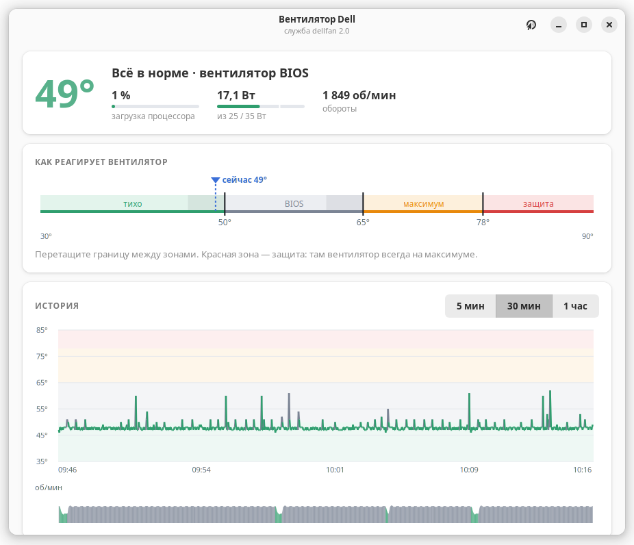
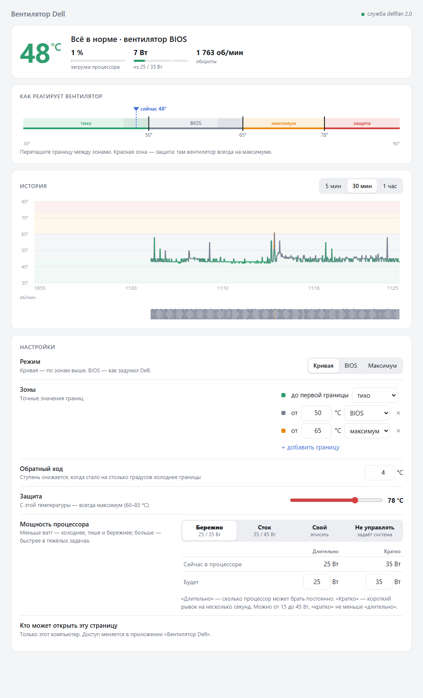

# Dell Pro Fan Control — кривая вентилятора и лимит мощности процессора для настольных Dell под Linux

[English](README.md) · **Русский**

На некоторых новых настольных Dell BIOS держит вентилятор на ~1750 об/мин, и из Linux это не
изменить: драйвер ядра `dell-smm-hwmon` разрешает ручное управление только моделям из своего
белого списка. **Dell Pro Fan Control** добавляет модель в этот список (небольшая правка драйвера через DKMS)
и запускает службу с температурной кривой, жёстким защитным порогом и, по желанию, лимитом
мощности процессора. Управление — из приложения или с веб-страницы.

| Приложение (GTK 4) | Веб-страница |
|---|---|
|  |  |

> **Состояние:** проверено только на одной модели — **Dell Pro Micro Plus QBM1250** (BIOS 1.18.2,
> Ubuntu 24.04, ядро 6.17 OEM). Программа меняет охлаждение вашего железа — используйте на свой
> риск и сначала прочитайте раздел [Безопасность](#безопасность).

Внутри служба называется `dellfan` (systemd, `/opt/dellfan`, группа `dellfan`).

> Неофициальный проект, не связан с Dell Inc. и не одобрен ею. «Dell» и «Dell Pro» — товарные знаки Dell Inc.

## Что умеет

- **Кривая вентилятора** из трёх ступеней, которые реально поддерживает железо:
  тихо (~1000 об/мин) · BIOS (~1750) · максимум (~4000). Границы зон перетаскиваются на шкале
  температур; «обратный ход» не даёт вентилятору дёргаться между ступенями.
- **Защитный порог** (60–85 °C): от него и выше вентилятор всегда на максимуме.
- **Лимит мощности процессора** (Intel RAPL): «Бережно 25/35 Вт», «Быстрее 35/45 Вт», свои
  значения (от 15 Вт до заводских значений компьютера, здесь 65/121 Вт) или «Не управлять» — оставить как задумал производитель. Учтите: заводские
  значения Dell намного выше — **65 Вт длительно / 121 Вт кратко** у Dell Pro Micro Plus, — и при
  «Не управлять» программа сразу возвращает значения, с которыми включился компьютер, без перезагрузки.
  Ставится лимит только на те «ручки» (зоны RAPL), которые прошивка включает сама (у этой модели —
  MSR; зона MMIO остаётся выключенной, как её оставляет Dell). Раз в 30 секунд служба сверяет лимит:
  если его поменяла другая программа (обычно защита Intel `thermald` при нагреве), это видно в
  приложении и на странице; если через 5 минут процессор холодный, а лимит чужой — ставится свой. В маленьком корпусе это заметно горячее.
- **Живые данные:** температура, обороты, загрузка процессора и ватты, история за 5 мин / 30 мин / 1 час.
- **Приложение** (GTK 4 + libadwaita, русский и английский) и **веб-страница**.

## Безопасность

Служба устроена так, что любой сбой заканчивается работающим вентилятором:

| Ситуация | Вентилятор |
|---|---|
| процессор на защитном пороге или выше | максимум, всегда |
| датчик температуры не читается | максимум |
| служба остановлена, упала или зависла | передаётся BIOS (systemd `ExecStopPost` + сторожевой таймер) |
| драйвер без управления вентилятором (например, после перехода на новую серию ядра) | BIOS — служба не запускается |
| удаление программы | BIOS |

Защитный порог нельзя поставить выше 85 °C, а границы кривой должны быть ниже него.
Приложение и веб-страница железо не трогают: все решения принимает служба.

## Что нужно

- Настольный Dell, на котором работает `dell-smm-hwmon` (см. [Другие модели Dell](#другие-модели-dell))
- Ubuntu / Debian с systemd (установщик использует `apt`), Python 3
- Интернет во время установки (исходник драйвера скачивается с kernel.org)
- Для приложения: GTK 4 и libadwaita 1.5+ (Ubuntu 24.04 и новее)

## Установка

```sh
git clone https://github.com/SerJo-32/dell-pro-fancontrol.git
cd dell-pro-fancontrol
sudo ./install.sh
```

Установщик:

1. проверяет модель (на непроверенных отказывается, если не указать `--force`);
2. скачивает `dell-smm-hwmon.c` для вашей серии ядра с kernel.org, накладывает правку из
   [`driver/`](driver/) и собирает через DKMS (при обновлениях ядра пересобирается сам);
3. ставит службу в `/opt/dellfan`, создаёт группу `dellfan`, включает `dellfan.service`;
4. ставит приложение («Вентилятор Dell» в меню) и добавляет вас в группу `dellfan`.

Ключи: `--no-gui` (сервер без рабочего стола), `--no-driver` (ваше ядро уже умеет управлять
вентилятором вашей модели), `--force` (пропустить проверку модели).

### Secure Boot

При включённом Secure Boot ядро загружает только подписанные доверенным ключом модули. Установщик
подписывает драйвер стандартным ключом MOK Ubuntu (создаст, если его нет) и в первый раз попросит
придумать **одноразовый пароль**. Дальше:

1. перезагрузите компьютер;
2. появится синий экран **MOK management** (ждёт 10 секунд — нажмите любую клавишу);
3. **Enroll MOK → Continue → Yes →** введите пароль **→ Reboot**.

Это делается один раз. Следующие обновления ядра подписываются автоматически.

## Как пользоваться

- **Приложение:** «Вентилятор Dell» в меню (после установки один раз выйдите из системы и войдите
  снова — чтобы заработало членство в группе `dellfan`).
- **Веб-страница:** сразу после установки открывается только **на самом Dell**: `http://127.0.0.1:8095`.
  Кто может её открыть, выбирается в приложении: **Настройки → Веб-страница**:

  | Доступ | Кто откроет страницу |
  |---|---|
  | **Этот компьютер** (по умолчанию) | только браузер на самом Dell |
  | **Вся сеть** | любое устройство дома: телефон, ноутбук. По умолчанию включено **«только просмотр»** — менять настройки тогда можно только в приложении |
  | **Выключена** | никто, страница не работает |

  Приложение само показывает, какой адрес открыть (например `http://192.168.1.50:8095`), и позволяет
  сменить порт, если 8095 занят другой программой. Пароля у страницы нет, поэтому при снятии
  «только просмотр» появляется предупреждение. Доступ меняется **только в приложении** — сама
  страница открыть себя для сети не может. Вентилятор работает, что бы ни случилось со страницей.
  - У Dell нет монитора, а открывать страницу для всей сети не хочется? Через SSH-туннель:
    `ssh -L 8095:127.0.0.1:8095 пользователь@адрес-dell`, затем на ноутбуке — `http://127.0.0.1:8095`.
- **Состояние и журнал:** `systemctl status dellfan`, `journalctl -u dellfan -b`

### Файл настроек

`/etc/dellfan/config.json` пишут приложение и веб-страница; руками его править почти не нужно.

```json
{
  "mode": "curve",
  "base_level": "quiet",
  "points": [{"temp": 50, "level": "bios"}, {"temp": 65, "level": "max"}],
  "hysteresis": 4,
  "safety_max": 75,
  "power": {"profile": "eco"},
  "web": {"access": "local", "port": 8095, "network_readonly": true}
}
```

- `mode` — `curve` (кривая), `bios` (как задумал Dell) или `max`
- `points` — с какой температуры (°C) какая ступень: `quiet`, `bios` или `max`
- `hysteresis` — ступень снижается, только когда стало на столько градусов холоднее границы
- `safety_max` — 60…85 °C
- `power.profile` — `eco` (25/35 Вт), `stock` (35/45 Вт, в интерфейсе «Быстрее»), `custom` с `pl1`/`pl2` или `off`
- `web.access` — `local`, `network` или `off`; `web.port` — 1024…65535; `web.network_readonly`
  (`/etc/default/dellfan` задаёт только начальное значение при первом запуске)

### API

Сокет приложения `/run/dellfan/dellfan.sock` (группа `dellfan`) и веб-порт говорят на HTTP + JSON:
`GET /api/status` (`?since=<unix-время>` — ограничить историю), `POST /api/config` — частичные настройки.

## Удаление

```sh
sudo ./uninstall.sh          # настройки в /etc/dellfan остаются
sudo ./uninstall.sh --purge  # удалить и настройки, и группу
```

Вентилятор возвращается под управление BIOS, снова загружается штатный драйвер ядра.
Ключ Secure Boot остаётся (им могут пользоваться другие DKMS-модули); убрать его:
`sudo mokutil --delete /var/lib/shim-signed/mok/MOK.der`.

## Если что-то не так

| Признак | Что проверить |
|---|---|
| `dellfan` не работает, в журнале *pwm1_enable not found* | не загружен наш драйвер: `dkms status`, `modinfo -F filename dell-smm-hwmon` должен указывать на `updates/dkms` |
| драйвер собрался, но не загружается, *Key was rejected* | ключ Secure Boot ещё не добавлен — перезагрузитесь и пройдите синий экран MOK |
| после обновления ядра на новую серию (например 6.17 → 6.18) управление пропало | снова запустите `sudo ./install.sh` — он скачает исходник для новой серии |
| приложение пишет, что не видит службу | выйдите из системы и войдите снова (группа `dellfan`) или проверьте `systemctl status dellfan` |

## Другие модели Dell

Правка добавляет ровно одну модель — `Dell Pro Micro Plus QBM1250` со способом управления
`30A3/31A3`. Другие новые настольные Dell, возможно, устроены так же, но **не рассчитывайте на это**:

1. посмотрите `cat /sys/class/dmi/id/product_name`;
2. впишите свою модель в [`driver/dell-smm-hwmon-qbm1250.patch`](driver/dell-smm-hwmon-qbm1250.patch)
   и в строку `SUPPORTED_MODELS` в `install.sh`;
3. установите и следите за `cat /sys/class/hwmon/hwmon*/fan1_input`, переключая режимы в приложении.

Получилось или нет — [напишите об этом](../../issues): модель, версия BIOS, результат.
Так список моделей и пополняется.

## В ядро Linux

Правильное решение на будущее — добавить модель в белый список самого ядра. Когда это попадёт в
ваше ядро, ставьте с `--no-driver` (или установщик сам заметит и не будет накладывать правку).

Сейчас: запрос — [Wer-Wolf/i8kutils#20](https://github.com/Wer-Wolf/i8kutils/issues/20)
(Dell Pro Micro Plus QBM1250). Правка «hwmon: (dell-smm) Add Dell Pro Micro Plus QBM1250 to fan
control whitelist» (Armin Wolf, соавтор и проверка — Sergei) **принята в hwmon-next в октябре 2026**
и должна попасть в один из следующих выпусков ядра Linux. Пока она не дошла до ядра вашего
дистрибутива, нужен драйвер из этого проекта.

## Лицензия

[GPL-2.0-or-later](LICENSE). Часть с драйвером сделана на основе `drivers/hwmon/dell-smm-hwmon.c`
из ядра Linux.

## Благодарности

- `dell-smm-hwmon` — Massimo Dal Zotto, Jean Delvare, Guenter Roeck, Pali Rohár, Armin Wolf
  и другие разработчики ядра
- [i8kutils](https://github.com/Wer-Wolf/i8kutils) — основные утилиты для этого драйвера
